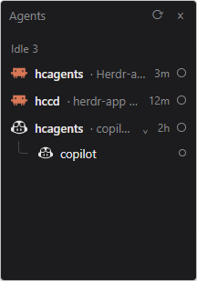

# hcagents

[日本語](README_ja.md)

A small always-on-top window that shows your [Herdr](https://herdr.dev) agents,
the way Herdr's own agents sidebar does: for keeping an eye on them while you
work in other apps.



- Lists every agent Herdr knows, grouped as **Pinned / Needs you (blocked) / Done / Working / Idle**,
  in the same order as Herdr (most urgent first, then the most recent change)
- Shows each agent's space, machine (for remote ones) and the same detail Herdr
  shows: a named tab, or the agent's title
- Sub-agents as a tree under their parent (collapsible)
- Click a row to switch Herdr to that agent's space and tab (a sub-agent opens
  as a peek). On Windows, Herdr's window is also brought to the front
- Pin / unpin agents (shared with Herdr)
- Herdr's own icons for agents and programs
- Frameless, always on top, lives in the system tray; remembers its position and size
- The look is plain HTML + CSS with readable class names: restyle it with your own stylesheet

Built with Go and [Wails v3](https://v3alpha.wails.io).

## Requirements

- Herdr: `herdr-app` and `hc` (herdr-core), on `PATH` or set in the config
- Windows 10/11 (WebView2), macOS 11+, or Linux (GTK 4, WebKitGTK 6.0)

Developed and used on Windows. The macOS and Linux builds are written but not tested yet.

## Build

Needs Go 1.27+, [Task](https://taskfile.dev) and the `wails3` CLI
(`go install github.com/wailsapp/wails/v3/cmd/wails3@v3.1.0`; only for the icon
and Windows resource files).

```sh
task build   # bin/hcagents.exe, bin/hcagents.app or bin/hcagents
task run     # build and start
```

| Task | What it does |
|---|---|
| `task build` | Build for this OS (no cross builds: macOS and Linux need cgo) |
| `task run` | Build and start |
| `task check` | gofmt and go vet |
| `task test` | go test |
| `task icons` | Make `build/windows/icon.ico` and `build/darwin/icons.icns` from `build/appicon.png` |
| `task navcheck` | Check which herdr-app command switches to each agent's space/tab |
| `task clean` | Remove `bin/` |

Without Task, `go build -ldflags "-H windowsgui" .` (Windows) or `go build .`
also works; the Windows exe then has no icon of its own.

## Usage

Start it and it sits in the corner of your screen and in the system tray.

- **Click a row**: go to that agent in Herdr
- **⌄** (on rows with sub-agents): collapse or expand them
- **Pin** (on hover, in place of the elapsed time): pin or unpin
- **Title bar**: drag to move; ⟳ refreshes now; × hides the window
- **Tray icon**: click to show / hide. Double-click (Windows) to switch Herdr to the agent at the top of the list, as a click on its row does; with no agents, it just opens Herdr's window. The menu has Show / Hide, Always on top, Theme (System / Light / Dark), Grow (Upward / Downward), Auto hide (When no agents / When all idle / Off), Opacity (100% to 30%), Status messages, Refresh and Quit
- **Window height**: follows the list, so the rows just fit. It grows upward (the bottom edge stays) or downward (the top edge stays), as chosen in the tray menu's Grow; at the edge of the screen it stops and the list scrolls
- **Auto hide**: the window hides itself when there are no agents (or, with When all idle, when every agent is idle) and comes back, without taking the focus, when that changes. A window shown or hidden by hand stays so until the next such change
- **Opacity**: the whole window can be see-through (tray menu's Opacity, 100% to 30%); it turns opaque while the pointer is over it
- **Status messages**: under each row, a small line with what the agent says it is doing now (Claude Code: the running tool), updated live. Turn it off with the tray menu's Status messages
- **Tray badge**: a dot on the tray icon for the most urgent group: red (Needs you), blue (Done) or yellow (Working); none when all are idle. The tooltip has the counts (not on macOS, which has no tray tooltips)

When Herdr's window isn't running, hcagents still lists the agents from herdr-core
(the title bar shows "core", with a note above the list). Clicking a row then
starts Herdr and, once it is up, switches to that agent. Pinning needs Herdr's window.

## Configuration

Optional. Copy [hcagents.example.yaml](hcagents.example.yaml) to `hcagents.yaml`,
either next to the executable or in your config folder:

| OS | Path |
|---|---|
| Windows | `%AppData%\hcagents\hcagents.yaml` |
| macOS | `~/Library/Application Support/hcagents/hcagents.yaml` |
| Linux | `~/.config/hcagents/hcagents.yaml` |

The first one found is used.

```yaml
herdr_app: ""     # herdr-app executable; empty: from PATH
hc: ""            # hc executable; empty: from PATH
herdr_home: ""    # Herdr's app folder (icons); empty: $HERDR_APP_HOME, else ~/.config/herdr-app
start_herdr: true # start Herdr on startup when it isn't running
interval: 10s     # how often to re-read Herdr's spaces and tabs while the window is shown
hidden_interval: 30s # ... and while it is hidden (statuses update live either way)
css: user.css     # your stylesheet, relative to this file; reloaded when it changes
theme: system     # system (follow the OS), light or dark; also set from the tray menu
grow: up          # the window's height follows the list: up (bottom edge stays) or down (top edge stays); also set from the tray menu
auto_hide: empty  # hide/show the window by itself: empty (no agents), idle (all agents idle) or off; also set from the tray menu
opacity: 100      # the whole window's opacity in percent, 30 to 100 in steps of 10 (opaque while the pointer is over it); also set from the tray menu
status_msg: true  # a line under each row with what the agent says it is doing now (Claude Code: the running tool), live; also set from the tray menu
window:
  width: 280      # size on first start (the height then follows the list)
  height: 360
  always_on_top: true
```

On macOS, apps started from Finder don't get your shell's `PATH` or `HERDR_APP_HOME`,
so set `herdr_app`, `hc` and `herdr_home` there.

Choosing a theme, a grow direction, an auto hide mode, an opacity or Status messages from the tray menu writes `theme:`, `grow:`, `auto_hide:`, `opacity:` or `status_msg:` to the config file in use, changing only that line.
With no config file, hcagents creates `hcagents.yaml` next to the executable (or, when that folder can't be written, and on macOS, in the config folder above).

The window's position and size are saved in `state.yaml`, next to `hcagents.yaml`
(or in the config folder above). Delete it to reset.

## Styling

Your stylesheet (`css:` in the config) is loaded after the built-in
[assets/style.css](assets/style.css), so it can override anything. The comment
at the top of that file describes the structure; in short:

```
.agents
  .group.is-pinned | .is-blocked | .is-done | .is-working | .is-idle
    .group-title (.group-name .group-count)
    .agent-item.is-<status> [.is-collapsed]
      .agent.is-<status> [.is-starting] [.is-pinned]
        .agent-icon .agent-name .agent-place .agent-toggle .agent-pin .agent-elapsed .agent-status
      .subagents
        .subagent-item.is-<status>
          .subagent (.subagent-icon .subagent-name .subagent-status)
          .subagents   (nested)
```

Most colors and sizes are CSS variables. `<html data-theme>` is `light` or `dark`: the dark colors are on `:root`, the light ones on `:root[data-theme="light"]`. For example:

```css
:root {
  --color-working: #b8860b;   /* the dark theme's colors (and sizes) */
  --font-size: 12px;
  --row-height: 26px;
}
:root[data-theme="light"] {
  --color-bg: #ffffff;        /* the light theme's colors */
  --color-fg: #222222;
}

/* hide the elapsed time */
.agent-elapsed { display: none; }
```

## Icons

Agent and program icons are Herdr's own, read at run time from Herdr's app
folder (`icons/`); hcagents doesn't ship them. Which icon a name gets comes from
a copy of Herdr's built-in program table, with your `programs.json` in Herdr's
folder merged over it, as Herdr does. If Herdr's folder isn't found, rows show a
letter instead.

## Notes

- **Done** is short-lived: Herdr turns it into idle once you look at the agent in Herdr.
- Sub-agent details come from the local herdr-core, so remote machines' sub-agents
  show with less detail.
- Bringing Herdr's window to the front after a click is Windows only for now.

## License

BSD 2-Clause. See [LICENSE](LICENSE).
