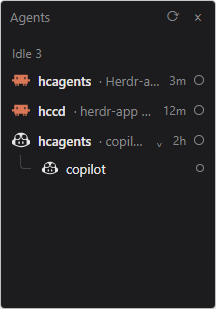

# hcagents

[English](README.md)

[Herdr](https://herdr.dev) のエージェントの状態を、Herdr のエージェント一覧と同じ形で表示する、常に最前面の小さなウィンドウです。ほかのアプリで作業しながら、エージェントの様子を見るためのものです。



- Herdr が把握しているすべてのエージェントを **Pinned / Needs you(blocked)/ Done / Working / Idle** に分けて表示します。並び順も Herdr と同じです(緊急度の高いもの、次に最近変化したものが先)。
- 各エージェントのスペース名、マシン名(リモートの場合)、Herdr と同じ詳細(名前付きのタブ名、またはエージェントのタイトル)を表示します。
- サブエージェントは親の下にツリーで表示します(折りたたみ可)。
- 行をクリックすると、Herdr がそのエージェントのスペースとタブに切り替わります(サブエージェントはピーク表示)。Windows では Herdr のウィンドウも前面に出ます。
- ピン留め / 解除ができます(Herdr と共有されます)。
- エージェントやプログラムのアイコンは Herdr のものを使います。
- 枠なし・常に最前面・システムトレイ常駐。ウィンドウの位置とサイズを覚えます。
- 見た目は素直な HTML と CSS で、クラス名もわかりやすくしてあります。自分のスタイルシートで変更できます。

Go と [Wails v3](https://v3alpha.wails.io) で作っています。

## 必要なもの

- Herdr: `herdr-app` と `hc`(herdr-core)。`PATH` に置くか、設定ファイルで指定します。
- Windows 10/11(WebView2)、macOS 11 以降、または Linux(GTK 4、WebKitGTK 6.0)

開発・利用は Windows で行っています。macOS と Linux 向けのビルドは用意していますが、まだ動作確認していません。

## ビルド

Go 1.27 以降、[Task](https://taskfile.dev)、`wails3` CLI が必要です(`go install github.com/wailsapp/wails/v3/cmd/wails3@v3.1.0`。アイコンと Windows のリソースファイルを作るときだけ使います)。

```sh
task build   # bin/hcagents.exe、bin/hcagents.app または bin/hcagents
task run     # ビルドして起動
```

| タスク | 内容 |
|---|---|
| `task build` | この OS 向けにビルド(macOS と Linux は cgo が必要なため、クロスビルドはしません) |
| `task run` | ビルドして起動 |
| `task check` | gofmt と go vet |
| `task test` | go test |
| `task icons` | `build/appicon.png` から `build/windows/icon.ico` と `build/darwin/icons.icns` を作る |
| `task navcheck` | どの herdr-app コマンドで各エージェントのスペース/タブに切り替わるかを確認 |
| `task clean` | `bin/` を削除 |

Task を使わずに `go build -ldflags "-H windowsgui" .`(Windows)や `go build .` でもビルドできます。その場合、Windows の exe には独自のアイコンが付きません。

## 使い方

起動すると、画面の隅とシステムトレイに常駐します。

- **行をクリック**: Herdr でそのエージェントに移動
- **⌄**(サブエージェントがある行): サブエージェントを折りたたむ / 開く
- **ピン**(マウスを乗せると経過時間の位置に出ます): ピン留め / 解除
- **タイトルバー**: ドラッグで移動。⟳ ですぐに更新、× でウィンドウを隠す
- **トレイアイコン**: クリックで表示 / 非表示。メニューには Show / Hide、Always on top、Theme(System / Light / Dark)、Grow(Upward / Downward)、Refresh、Quit があります。
- **ウィンドウの高さ**: 一覧に合わせて、行がちょうど収まる高さに変わります。伸び縮みする向きはトレイメニューの Grow で選べます。上向き(下端を固定)か下向き(上端を固定)です。画面の端まで来るとそれ以上は伸びず、一覧がスクロールします
- **トレイのバッジ**: 一番急ぎのグループに応じて、トレイアイコンに丸が付きます。赤(Needs you)、青(Done)、黄(Working)で、すべて Idle なら付きません。ツールチップには件数が出ます(macOS はトレイのツールチップがないため出ません)

Herdr のウィンドウが起動していないときも、herdr-core からエージェントの一覧を表示します(タイトルバーに「core」、一覧の上に注意書きが出ます)。このとき行をクリックすると Herdr を起動し、起動を待ってからそのエージェントに切り替えます。ピン留めは Herdr のウィンドウが起動しているときだけ使えます。

## 設定

設定は任意です。[hcagents.example.yaml](hcagents.example.yaml) を `hcagents.yaml` という名前で、実行ファイルと同じフォルダか、次の設定フォルダに置きます。

| OS | 場所 |
|---|---|
| Windows | `%AppData%\hcagents\hcagents.yaml` |
| macOS | `~/Library/Application Support/hcagents/hcagents.yaml` |
| Linux | `~/.config/hcagents/hcagents.yaml` |

最初に見つかったものを使います。

```yaml
herdr_app: ""     # herdr-app の実行ファイル。空なら PATH から探す
hc: ""            # hc の実行ファイル。空なら PATH から探す
herdr_home: ""    # Herdr のアプリフォルダ(アイコン用)。空なら $HERDR_APP_HOME、なければ ~/.config/herdr-app
start_herdr: true # 起動時、Herdr が起動していなければ起動する
interval: 5s      # ウィンドウ表示中の更新間隔
hidden_interval: 10s # 非表示中の更新間隔(表示したときはすぐ更新する)
css: user.css     # 自分のスタイルシート。このファイルからの相対パス。変更すると自動で再読み込み
theme: system     # 配色。system(OS に合わせる)、light、dark。トレイメニューからも変えられる
grow: up          # 一覧に合わせて高さを変える向き。up(下端を固定)か down(上端を固定)。トレイメニューからも変えられる
window:
  width: 280      # 初回起動時のサイズ(その後、高さは一覧に合わせて変わる)
  height: 360
  always_on_top: true
```

macOS で Finder から起動したアプリには、シェルの `PATH` や `HERDR_APP_HOME` が渡りません。`herdr_app`、`hc`、`herdr_home` を設定してください。

トレイメニューでテーマや伸縮の向きを選ぶと、使用中の設定ファイルの `theme:` や `grow:` の行だけを書き換えます。設定ファイルがなければ、実行ファイルと同じフォルダに `hcagents.yaml` を作ります(そのフォルダに書き込めないときと macOS では、上の設定フォルダに作ります)。

ウィンドウの位置とサイズは、`hcagents.yaml` と同じフォルダ(なければ上の設定フォルダ)の `state.yaml` に保存されます。消すと初期状態に戻ります。

## 見た目の変更

自分のスタイルシート(設定の `css:`)は、組み込みの [assets/style.css](assets/style.css) の後に読み込まれるので、何でも上書きできます。構造はそのファイル冒頭のコメントにあります。概略は次のとおりです。

```
.agents
  .group.is-pinned | .is-blocked | .is-done | .is-working | .is-idle
    .group-title (.group-name .group-count)
    .agent-item.is-<status> [.is-collapsed]
      .agent.is-<status> [.is-starting] [.is-pinned]
        .agent-icon .agent-name .agent-place .agent-toggle .agent-pin .agent-elapsed .agent-status
      .subagents
        .subagent-item.is-<status>
          .subagent (.subagent-icon .subagent-name .subagent-status)
          .subagents   (入れ子)
```

色やサイズの多くは CSS 変数になっています。`<html data-theme>` は `light` か `dark` で、ダークの色は `:root`、ライトの色は `:root[data-theme="light"]` にあります。例:

```css
:root {
  --color-working: #b8860b;   /* ダークテーマの色(とサイズ) */
  --font-size: 12px;
  --row-height: 26px;
}
:root[data-theme="light"] {
  --color-bg: #ffffff;        /* ライトテーマの色 */
  --color-fg: #222222;
}

/* 経過時間を隠す */
.agent-elapsed { display: none; }
```

## アイコン

エージェントやプログラムのアイコンは Herdr のもので、実行時に Herdr のアプリフォルダ(`icons/`)から読み込みます。hcagents 自体にはアイコンを含めていません。どの名前にどのアイコンを使うかは、Herdr に組み込まれている対応表の写しに、Herdr のフォルダにある `programs.json` を重ねて決めます(Herdr と同じ方法です)。Herdr のフォルダが見つからないときは、代わりに頭文字を表示します。

## 注意点

- **Done** は短命です。Herdr でそのエージェントを見ると Idle に変わります。
- サブエージェントの詳細はローカルの herdr-core から取得するため、リモートマシンのサブエージェントは表示される情報が少なくなります。
- クリック後に Herdr のウィンドウを前面に出す動作は、今のところ Windows のみです。

## ライセンス

BSD 2-Clause です。[LICENSE](LICENSE) を参照してください。
